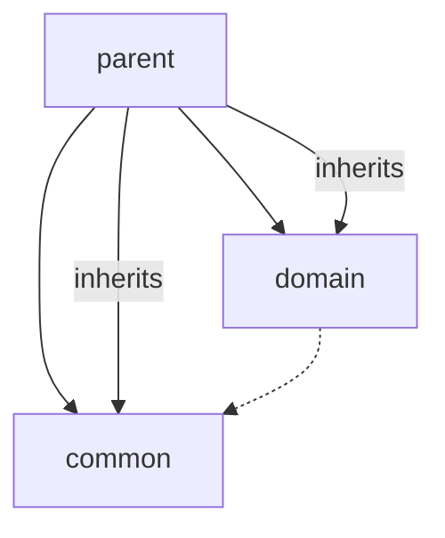

# Maven Architecture Plugin

`maven-architecture-plugin` 0.0.1-SNAPSHOT produces a Mermaid flowchart from the
projects in the **selected Maven reactor**. It uses Maven's effective project
models, not a second pass over POM files. The diagram distinguishes aggregation
(listed `<modules>`), inheritance (`<parent>`), and declared direct dependencies.
It does **not** analyze Java classes or packages.

## Requirements and installation

Java 17 or later is required. Development and integration tests have been
verified with Maven 3.9.16 and Java 17; other Maven versions have not been
verified.

```bash
mvn clean install
```

This runs JUnit 5 tests and a Maven Invoker integration test against
`src/test/resources/projects/sample-multimodule`. The fixture has `common`,
`domain`, `infrastructure`, `api`, and `application` modules; it verifies both
the default and test-dependency-enabled diagrams. The second invocation runs
offline against the Invoker's local repository.

GitHub Actions runs `mvn -B --no-transfer-progress clean install` with Java 17
on pushes, pull requests, and manual workflow dispatches.

## Usage

Run from the root of a multi-module project (after installing the plugin):

```bash
mvn io.github.mjhaugsdal:maven-architecture-plugin:0.0.1-SNAPSHOT:diagram
```

To use the short form `mvn architecture:diagram`, declare the plugin under
`<build><plugins>` in the root POM, or add `io.github.mjhaugsdal` to
`<pluginGroups>` in Maven's `settings.xml`. The Maven goal prefix is
`architecture`. A POM configuration example:

```xml
<build>
  <plugins>
    <plugin>
      <groupId>io.github.mjhaugsdal</groupId>
      <artifactId>maven-architecture-plugin</artifactId>
      <version>0.0.1-SNAPSHOT</version>
      <configuration>
        <outputFile>${project.build.directory}/architecture/architecture.mmd</outputFile>
        <includeModuleHierarchy>true</includeModuleHierarchy>
        <includeDependencies>true</includeDependencies>
        <includeTestDependencies>false</includeTestDependencies>
        <includeExternalDependencies>false</includeExternalDependencies>
      </configuration>
    </plugin>
  </plugins>
</build>
```

Options and corresponding command-line properties:

| Option | Property | Default |
| --- | --- | --- |
| `outputFile` | `architecture.outputFile` | `${project.build.directory}/architecture/architecture.mmd` |
| `includeModuleHierarchy` | `architecture.includeModuleHierarchy` | `true` |
| `includeDependencies` | `architecture.includeDependencies` | `true` |
| `includeTestDependencies` | `architecture.includeTestDependencies` | `false` |
| `includeExternalDependencies` | `architecture.includeExternalDependencies` | `false` (enabling it currently fails with an explanatory error) |

For example:

```bash
mvn architecture:diagram -Darchitecture.outputFile=target/my-diagram.mmd
mvn architecture:diagram -Darchitecture.includeTestDependencies=true
```

The generated file is UTF-8 and its parent directory is created automatically.
If the content is unchanged, the existing file is left untouched. Generation
does not require Mermaid CLI or a browser.

## Diagram semantics

For a reactor with a parent POM aggregating `common` and `domain`, and a
declared dependency from `domain` to `common`, an excerpt might be:



Solid arrows represent aggregation; solid arrows labeled `inherits` represent
parent-POM inheritance; dotted arrows represent dependencies. A project can
have both aggregation and inheritance edges, or neither. Node IDs are
deterministic and independent of artifact IDs. Names that collide are
disambiguated by group ID and version. The graph keeps dependency scopes even
though the initial diagram does not display them.

Only dependencies declared by projects in the reactor are considered. Compile
and runtime scopes are included by default; test scope is opt-in. Managed-only,
provided, system, classifier-specific, and external dependencies are not
rendered. Projects omitted from the selected reactor (for example with `-pl`)
are not invented in the diagram.

## Design and limitations

`model/` contains the Mermaid-independent graph, `scanner/` maps Maven
projects into that graph, `generator/` renders Mermaid, `writer/` persists the
output, and `mojo/` owns Maven configuration. The plugin is a single Maven
module. The Java package `io.github.mjhaugsdal.architecture` is
project-specific, not the `com.example` placeholder.

Version 0.0.1 only supports Mermaid module-level diagrams. It does not resolve
transitive dependencies, render external libraries, inspect source code,
report cycles, or enforce architecture rules. Future releases could add other
diagram formats, grouping, class/package analysis, and architecture validation
without changing the Maven scanner's graph semantics.

To prepare a 0.0.1 release, replace the development
`0.0.1-SNAPSHOT` version with `0.0.1`, run `mvn clean install`, and publish
the artifact using your chosen Maven release process.
