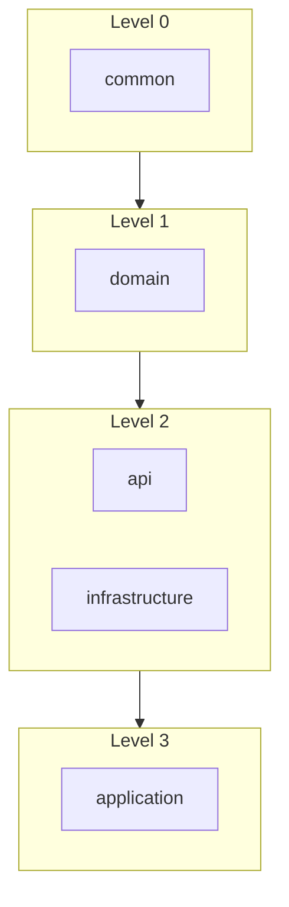
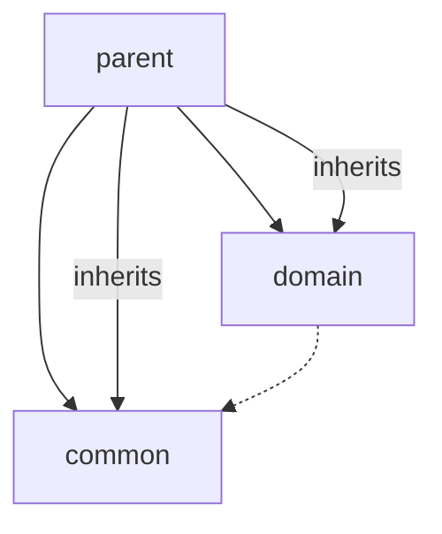

# Maven Architecture Plugin

`maven-architecture-plugin` 0.0.1-SNAPSHOT produces a Mermaid flowchart from the
projects in the **selected Maven reactor**. It uses Maven's effective project
models, not a second pass over POM files. By default it draws a simplified
**build-level** diagram showing which modules can be built in parallel; a
`full` diagram distinguishing aggregation (listed `<modules>`), inheritance
(`<parent>`), and declared direct dependencies is also available. It does
**not** analyze Java classes or packages.

## Requirements and installation

Java 17 or later is required. Development and integration tests have been
verified with Maven 3.9.16 and Java 17; other Maven versions have not been
verified.

```bash
mvn clean install
```

This runs JUnit 5 tests and a Maven Invoker integration test against
`src/test/resources/projects/sample-multimodule`. The fixture has `common`,
`domain`, `infrastructure`, `api`, and `application` modules; it verifies both
the default and test-dependency-enabled diagrams. The second invocation runs
offline against the Invoker's local repository.

GitHub Actions runs `mvn -B --no-transfer-progress clean install` with Java 17
on pushes, pull requests, and manual workflow dispatches.

## Usage

Run from the root of a multi-module project (after installing the plugin):

```bash
mvn io.github.mjhaugsdal:maven-architecture-plugin:0.0.1-SNAPSHOT:diagram
```

To use the short form `mvn architecture:diagram`, declare the plugin under
`<build><plugins>` in the root POM, or add `io.github.mjhaugsdal` to
`<pluginGroups>` in Maven's `settings.xml`. The Maven goal prefix is
`architecture`. A POM configuration example:

```xml
<build>
  <plugins>
    <plugin>
      <groupId>io.github.mjhaugsdal</groupId>
      <artifactId>maven-architecture-plugin</artifactId>
      <version>0.0.1-SNAPSHOT</version>
      <configuration>
        <diagramType>build-levels</diagramType>
        <outputFile>${project.build.directory}/architecture/architecture.mmd</outputFile>
        <includeModuleHierarchy>true</includeModuleHierarchy>
        <includeDependencies>true</includeDependencies>
        <includeTestDependencies>false</includeTestDependencies>
        <includeExternalDependencies>false</includeExternalDependencies>
      </configuration>
    </plugin>
  </plugins>
</build>
```

Options and corresponding command-line properties:

| Option | Property | Default |
| --- | --- | --- |
| `diagramType` | `architecture.diagramType` | `build-levels` (or `full`) |
| `outputFile` | `architecture.outputFile` | `${project.build.directory}/architecture/architecture.mmd` |
| `includeModuleHierarchy` | `architecture.includeModuleHierarchy` | `true` |
| `includeDependencies` | `architecture.includeDependencies` | `true` |
| `includeTestDependencies` | `architecture.includeTestDependencies` | `false` |
| `includeExternalDependencies` | `architecture.includeExternalDependencies` | `false` (enabling it currently fails with an explanatory error) |

For example:

```bash
mvn architecture:diagram -Darchitecture.outputFile=target/my-diagram.mmd
mvn architecture:diagram -Darchitecture.diagramType=full -Darchitecture.includeTestDependencies=true
```

The `includeModuleHierarchy`, `includeDependencies` and `includeTestDependencies`
options only apply to the `full` diagram.

The generated file is UTF-8 and its parent directory is created automatically.
If the content is unchanged, the existing file is left untouched. Generation
does not require Mermaid CLI or a browser.

## Build-level diagram

Each module is placed on the level after the highest level of any reactor
module it declares a dependency on; modules without reactor dependencies are on
level 0. Modules on the same level do not depend on each other and can be built
in parallel (for example with `mvn -T`). For the sample fixture:



Only module-to-module dependencies inside the reactor are used, and every
scope counts (including `test` and `provided`, and classified artifacts such as
`test-jar`), because Maven orders the reactor on all of them. Parent/inheritance
and aggregation relationships are not drawn and do not affect levels.
Aggregator POMs (projects listing `<modules>`) are omitted unless another module
depends on them or they declare reactor dependencies themselves. External
dependencies are ignored. A dependency cycle fails the goal.

## Full diagram semantics

For a reactor with a parent POM aggregating `common` and `domain`, and a
declared dependency from `domain` to `common`, an excerpt might be:



Solid arrows represent aggregation; solid arrows labeled `inherits` represent
parent-POM inheritance; dotted arrows represent dependencies. A project can
have both aggregation and inheritance edges, or neither. Node IDs are
deterministic and independent of artifact IDs. Names that collide are
disambiguated by group ID and version. The graph keeps dependency scopes even
though the initial diagram does not display them.

Only dependencies declared by projects in the reactor are considered. Compile
and runtime scopes are included by default; test scope is opt-in. Managed-only,
provided, system, classifier-specific, and external dependencies are not
rendered. Projects omitted from the selected reactor (for example with `-pl`)
are not invented in the diagram.

## Design and limitations

`model/` contains the Mermaid-independent graph, `scanner/` maps Maven
projects into that graph, `generator/` renders Mermaid, `writer/` persists the
output, and `mojo/` owns Maven configuration. The plugin is a single Maven
module. The Java package `io.github.mjhaugsdal.architecture` is
project-specific, not the `com.example` placeholder.

Version 0.0.1 only supports Mermaid module-level diagrams. It does not resolve
transitive dependencies, render external libraries, inspect source code, or enforce architecture rules. Future releases could add other
diagram formats, grouping, class/package analysis, and architecture validation
without changing the Maven scanner's graph semantics.

## Releasing locally to Maven Central

Releases use the [Sonatype Central Portal](https://central.sonatype.com/),
not the retired OSSRH staging service. The opt-in `release` Maven profile
attaches source and Javadoc JARs, signs the POM and all three JARs with your
local GPG key, and uploads them to the Portal at `deploy`. Ordinary
`mvn clean install` builds do not need GPG or publishing credentials.
The profile rejects `-SNAPSHOT` project versions.

### One-time setup

1. Install Java 17 or later, Maven 3.9.2 or later, and GnuPG 2.x on your
   workstation.
2. Sign in to the Central Portal and verify ownership of the namespace
   `io.github.mjhaugsdal` under **Namespaces**. Follow the Portal's GitHub
   ownership verification instructions; having a matching Maven group ID
   alone is not enough to publish.
3. Generate a **user token** in the Portal. Merge this server entry into your
   local `~/.m2/settings.xml` (do not replace any existing settings):

   ```xml
   <settings xmlns="http://maven.apache.org/SETTINGS/1.2.0"
             xmlns:xsi="http://www.w3.org/2001/XMLSchema-instance"
             xsi:schemaLocation="http://maven.apache.org/SETTINGS/1.2.0 https://maven.apache.org/xsd/settings-1.2.0.xsd">
     <servers>
       <server>
         <id>central</id>
         <username>${env.CENTRAL_USERNAME}</username>
         <password>${env.CENTRAL_PASSWORD}</password>
       </server>
     </servers>
   </settings>
   ```

   `CENTRAL_USERNAME` and `CENTRAL_PASSWORD` are the token's generated
   username and password, **not** your GitHub or Portal login. Set them only
   in the shell used to deploy. For Bash, read them without putting the
   values into shell history:

   ```bash
   read -r -p "Central token username: " CENTRAL_USERNAME
   read -r -s -p "Central token password: " CENTRAL_PASSWORD; printf '\n'
   export CENTRAL_USERNAME CENTRAL_PASSWORD
   ```

   Keep settings, tokens, private keys, and passphrases outside this repository.
   Do not pass credentials or a GPG passphrase as Maven `-D` arguments or
   enable debug logging during publishing.
4. Find the fingerprint of your existing signing key and publish its
   **public** key so Central can verify signatures:

   ```bash
   gpg --list-secret-keys --keyid-format long
   export GPG_KEY_FINGERPRINT=YOUR_FULL_KEY_FINGERPRINT
   gpg --keyserver hkps://keyserver.ubuntu.com --send-keys "$GPG_KEY_FINGERPRINT"
   ```

   The key must be unexpired and have signing capability. Never export or
   upload its private key. On macOS/Linux, set `export GPG_TTY=$(tty)` in your
   release shell so GPG's pinentry prompt can use your terminal. Signing uses
   `gpg-agent`; keep Maven interactive (do not use `-B`) so it can prompt for
   the key's passphrase. If pinentry fails, check your local GnuPG/pinentry
   installation before proceeding.

### Prepare and check a release

Start from a clean checkout of the commit you intend to release. Change only
the root POM's project version from `0.0.1-SNAPSHOT` to `0.0.1` (choose a new,
unused version for later releases). Update the usage examples above to that
release version as well. Do not change dependency versions or the Invoker
fixtures; integration tests obtain the plugin version from the root POM.

Run from the repository root:

```bash
mvn clean install
mvn -Prelease -Dgpg.keyname="$GPG_KEY_FINGERPRINT" clean verify
```

The second command runs unit/integration tests, generates source and Javadoc
JARs, and signs the release artifacts, but **does not upload anything**.
For `0.0.1`, check that `target/` contains:

- `maven-architecture-plugin-0.0.1.jar`
- `maven-architecture-plugin-0.0.1-sources.jar`
- `maven-architecture-plugin-0.0.1-javadoc.jar`
- `maven-architecture-plugin-0.0.1.pom`
- An `.asc` signature alongside each JAR and the POM.

For example, verify a signature locally:

```bash
gpg --verify target/maven-architecture-plugin-0.0.1.jar.asc \
  target/maven-architecture-plugin-0.0.1.jar
```

Commit the release version/documentation changes and tag that exact commit
(for example, `v0.0.1`) using your normal Git workflow before uploading.

### Upload, review, and publish

With the token variables set in the same terminal, run:

```bash
mvn -Prelease -Dgpg.keyname="$GPG_KEY_FINGERPRINT" clean deploy
```

This rebuilds, tests, signs, uploads, and waits for Central's validation.
`autoPublish` is deliberately **false**: a successful command means the
deployment is validated, not that it is public. Open **Publishing** in the
Central Portal, review the uploaded coordinates and files, and click
**Publish**. If validation fails, inspect the Portal errors and correct them
before publishing. If Maven times out or loses its connection after upload,
check the Portal for the existing deployment before uploading again.

Publishing is irreversible, and a published version cannot be overwritten.
Wait for the Portal to report **PUBLISHED** and for Central propagation, then
test from a separate Maven project:

```bash
mvn io.github.mjhaugsdal:maven-architecture-plugin:0.0.1:diagram
```

After publication, change the root POM to the next development version
(for example, `0.0.2-SNAPSHOT`) and commit it. Clear credentials from the shell:

```bash
unset CENTRAL_USERNAME CENTRAL_PASSWORD
```

See Sonatype's [Maven publishing guide](https://central.sonatype.org/publish/publish-portal-maven/)
and [GPG requirements](https://central.sonatype.org/publish/requirements/gpg/)
for Portal and signing troubleshooting.
