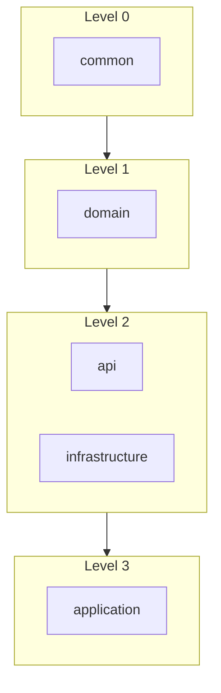
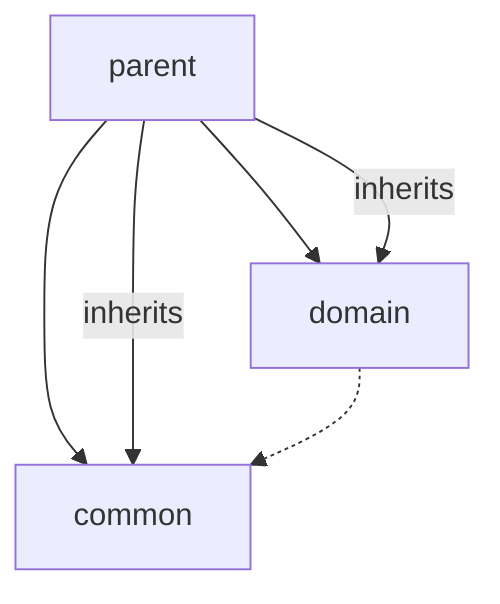

# Maven Architecture Plugin

`maven-architecture-plugin` 0.0.1-SNAPSHOT produces Mermaid flowcharts and a
versioned JSON graph from the projects in the **selected Maven reactor**. It uses Maven's effective project
models, not a second pass over POM files. By default it draws a simplified
**build-level** diagram showing which modules can be built in parallel; a
`full` diagram distinguishing aggregation (listed `<modules>`), inheritance
(`<parent>`), and declared direct dependencies is also available. It does
**not** analyze Java classes or packages.

## Requirements and installation

Java 17 or later is required. Development and integration tests have been
verified with Maven 3.9.16 and Java 17; other Maven versions have not been
verified.

```bash
mvn clean install
```

This runs JUnit 5 tests and a Maven Invoker integration test against
`src/test/resources/projects/sample-multimodule`. The fixture has `common`,
`domain`, `infrastructure`, `api`, and `application` modules; it verifies both
the default and test-dependency-enabled diagrams. The second invocation runs
offline against the Invoker's local repository.

GitHub Actions runs `mvn -B --no-transfer-progress clean install` with Java 17
on pushes, pull requests, and manual workflow dispatches.

## Usage

Run from the root of a multi-module project (after installing the plugin):

```bash
mvn io.github.mjhaugsdal:maven-architecture-plugin:0.0.1-SNAPSHOT:diagram
```

To use the short form `mvn architecture:diagram`, declare the plugin under
`<build><plugins>` in the root POM, or add `io.github.mjhaugsdal` to
`<pluginGroups>` in Maven's `settings.xml`. The Maven goal prefix is
`architecture`. A POM configuration example:

```xml
<build>
  <plugins>
    <plugin>
      <groupId>io.github.mjhaugsdal</groupId>
      <artifactId>maven-architecture-plugin</artifactId>
      <version>0.0.1-SNAPSHOT</version>
      <configuration>
        <diagramType>build-levels</diagramType>
        <outputFile>${project.build.directory}/architecture/architecture.mmd</outputFile>
        <includeModuleHierarchy>true</includeModuleHierarchy>
        <includeDependencies>true</includeDependencies>
        <includeTestDependencies>false</includeTestDependencies>
        <includeExternalDependencies>false</includeExternalDependencies>
      </configuration>
    </plugin>
  </plugins>
</build>
```

Options and corresponding command-line properties:

| Option | Property | Default |
| --- | --- | --- |
| `diagramType` | `architecture.diagramType` | `build-levels` (or `full`) |
| `outputFile` | `architecture.outputFile` | `${project.build.directory}/architecture/architecture.mmd` |
| `includeModuleHierarchy` | `architecture.includeModuleHierarchy` | `true` |
| `includeDependencies` | `architecture.includeDependencies` | `true` |
| `includeTestDependencies` | `architecture.includeTestDependencies` | `false` |
| `includeExternalDependencies` | `architecture.includeExternalDependencies` | `false` (enabling it currently fails with an explanatory error) |

For example:

```bash
mvn architecture:diagram -Darchitecture.outputFile=target/my-diagram.mmd
mvn architecture:diagram -Darchitecture.diagramType=full -Darchitecture.includeTestDependencies=true
```

The `includeModuleHierarchy`, `includeDependencies` and `includeTestDependencies`
options only apply to the `full` diagram.

## Circular dependency report

Run the `cycles` goal to report each cyclic strongly connected component, its
participating module coordinates, and a representative closed dependency path:

```bash
mvn io.github.mjhaugsdal:maven-architecture-plugin:0.0.1-SNAPSHOT:cycles
```

By default, the goal writes only to the Maven log. To also write a Mermaid
diagram containing only cyclic components:

```bash
mvn architecture:cycles -Darchitecture.includeCycleDiagram=true \
  -Darchitecture.cycleDiagramFile=target/circular-dependencies.mmd
```

The diagram option defaults to `false`; its destination defaults to
`${project.build.directory}/architecture/circular-dependencies.mmd`. Cycle
analysis uses all reactor dependencies, including every scope and classifier,
to match Maven build ordering. Build-level diagram errors use the same cycle
diagnostic as this report. Maven may reject an actual cyclic reactor before it
can run a goal; the graph analyzer itself is Maven-independent and can analyze
such graph fixtures directly.

## JSON graph export

Export the complete declared architecture graph independently of the Mermaid
filters:

```bash
mvn io.github.mjhaugsdal:maven-architecture-plugin:0.0.1-SNAPSHOT:json
mvn architecture:json -Darchitecture.jsonOutputFile=target/architecture/graph.json
```

The `json` goal defaults to
`${project.build.directory}/architecture/architecture.json`. Schema version 1
has top-level `schemaVersion`, `nodes`, and `edges` fields. `nodes` contains
reactor modules (`kind: "module"`) and external dependency artifacts
(`kind: "external"`). Module node metadata is allowlisted to Maven coordinates,
packaging, name, and parent ID; external node metadata is coordinates, type,
and classifier. Filesystem directories and arbitrary Maven properties are
never exported.

Node IDs are stable coordinate-based values: `module:<groupId>:<artifactId>:<version>`
and `external:<groupId>:<artifactId>:<version>:<type>:<classifier>`, with each
coordinate component UTF-8 URL-encoded (a missing component is `~`). Edges are
ordered aggregation, inheritance, and dependency relationships. Dependency
edges preserve declared scope, version, type, and classifier, including
external dependencies and scopes omitted from the Mermaid diagrams. Modules,
external nodes, edges, and object fields have deterministic ordering, so
shuffling the reactor input produces identical JSON.

The integration-test consumer parses this output with Groovy's JSON parser and
checks module and external nodes, all edge kinds, and dependency metadata.

The generated file is UTF-8 and its parent directory is created automatically.
If the content is unchanged, the existing file is left untouched. Generation
does not require Mermaid CLI or a browser.

## Build-level diagram

Each module is placed on the level after the highest level of any reactor
module it declares a dependency on; modules without reactor dependencies are on
level 0. Modules on the same level do not depend on each other and can be built
in parallel (for example with `mvn -T`). For the sample fixture:



Only module-to-module dependencies inside the reactor are used, and every
scope counts (including `test` and `provided`, and classified artifacts such as
`test-jar`), because Maven orders the reactor on all of them. Parent/inheritance
and aggregation relationships are not drawn and do not affect levels.
Aggregator POMs (projects listing `<modules>`) are omitted unless another module
depends on them or they declare reactor dependencies themselves. External
dependencies are ignored. A dependency cycle fails the goal with the same
component and path diagnostics used by the circular dependency report.

## Full diagram semantics

For a reactor with a parent POM aggregating `common` and `domain`, and a
declared dependency from `domain` to `common`, an excerpt might be:



Solid arrows represent aggregation; solid arrows labeled `inherits` represent
parent-POM inheritance; dotted arrows represent dependencies. A project can
have both aggregation and inheritance edges, or neither. Node IDs are
deterministic and independent of artifact IDs. Names that collide are
disambiguated by group ID and version. The graph keeps dependency scopes even
though the initial diagram does not display them.

Only dependencies declared by projects in the reactor are considered. Compile
and runtime scopes are included by default; test scope is opt-in. Managed-only,
provided, system, classifier-specific, and external dependencies are not
rendered. Projects omitted from the selected reactor (for example with `-pl`)
are not invented in the diagram.

## Design and limitations

`model/` contains the Mermaid-independent graph, `scanner/` maps Maven
projects into that graph, `generator/` renders Mermaid, `writer/` persists the
output, and `mojo/` owns Maven configuration. The plugin is a single Maven
module. The Java package `io.github.mjhaugsdal.architecture` is
project-specific, not the `com.example` placeholder.

Version 0.0.1 supports Mermaid module-level diagrams, JSON export of direct
declared dependencies, and direct dependency cycle reports. It does not resolve
transitive dependencies, inspect source code, or enforce architecture rules.
See the [roadmap](ROADMAP.md) for planned visualization, analysis, and
validation work.

To prepare a 0.0.1 release, replace the development
`0.0.1-SNAPSHOT` version with `0.0.1`, run `mvn clean install`, and publish
the artifact using your chosen Maven release process.
