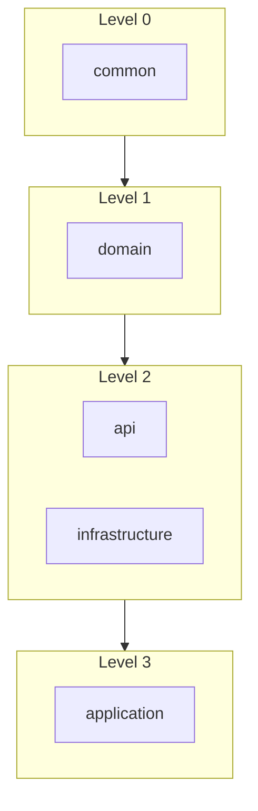
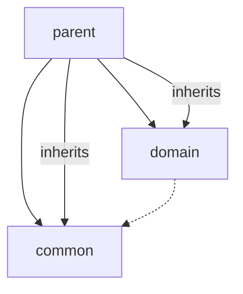

# Maven Architecture Plugin

`maven-architecture-plugin` 0.0.1-SNAPSHOT produces a Mermaid flowchart from the
projects in the **selected Maven reactor**. It uses Maven's effective project
models, not a second pass over POM files. By default it draws a simplified
**build-level** diagram showing which modules can be built in parallel; a
`full` diagram distinguishing aggregation (listed `<modules>`), inheritance
(`<parent>`), and declared direct dependencies is also available. It does
**not** analyze Java classes or packages.

## Requirements and installation

Java 17 or later is required. Development and integration tests have been
verified with Maven 3.9.16 and Java 17; other Maven versions have not been
verified.

```bash
mvn clean install
```

This runs JUnit 5 tests and a Maven Invoker integration test against
`src/test/resources/projects/sample-multimodule`. The fixture has `common`,
`domain`, `infrastructure`, `api`, and `application` modules; it verifies both
the default and test-dependency-enabled diagrams. The second invocation runs
offline against the Invoker's local repository.

GitHub Actions runs `mvn -B --no-transfer-progress clean install` with Java 17
on pushes, pull requests, and manual workflow dispatches.

## Usage

Run from the root of a multi-module project (after installing the plugin):

```bash
mvn io.github.mjhaugsdal:maven-architecture-plugin:0.0.1-SNAPSHOT:diagram
```

To use the short form `mvn architecture:diagram`, declare the plugin under
`<build><plugins>` in the root POM, or add `io.github.mjhaugsdal` to
`<pluginGroups>` in Maven's `settings.xml`. The Maven goal prefix is
`architecture`. A POM configuration example:

```xml
<build>
  <plugins>
    <plugin>
      <groupId>io.github.mjhaugsdal</groupId>
      <artifactId>maven-architecture-plugin</artifactId>
      <version>0.0.1-SNAPSHOT</version>
      <configuration>
        <diagramType>build-levels</diagramType>
        <outputFile>${project.build.directory}/architecture/architecture.mmd</outputFile>
        <includeModuleHierarchy>true</includeModuleHierarchy>
        <includeDependencies>true</includeDependencies>
        <includeTestDependencies>false</includeTestDependencies>
        <includeExternalDependencies>false</includeExternalDependencies>
      </configuration>
    </plugin>
  </plugins>
</build>
```

Options and corresponding command-line properties:

| Option | Property | Default |
| --- | --- | --- |
| `diagramType` | `architecture.diagramType` | `build-levels` (or `full`) |
| `outputFile` | `architecture.outputFile` | `${project.build.directory}/architecture/architecture.mmd` |
| `includeModuleHierarchy` | `architecture.includeModuleHierarchy` | `true` |
| `includeDependencies` | `architecture.includeDependencies` | `true` |
| `includeTestDependencies` | `architecture.includeTestDependencies` | `false` |
| `includeExternalDependencies` | `architecture.includeExternalDependencies` | `false` |

For example:

```bash
mvn architecture:diagram -Darchitecture.outputFile=target/my-diagram.mmd
mvn architecture:diagram -Darchitecture.diagramType=full -Darchitecture.includeTestDependencies=true
```

The `includeModuleHierarchy`, `includeDependencies`, `includeTestDependencies`
and `includeExternalDependencies` options only apply to the `full` diagram.

The generated file is UTF-8 and its parent directory is created automatically.
If the content is unchanged, the existing file is left untouched. Generation
does not require Mermaid CLI or a browser.

## Build-level diagram

Each module is placed on the level after the highest level of any reactor
module it declares a dependency on; modules without reactor dependencies are on
level 0. Modules on the same level do not depend on each other and can be built
in parallel (for example with `mvn -T`). For the sample fixture:



Only module-to-module dependencies inside the reactor are used, and every
scope counts (including `test` and `provided`, and classified artifacts such as
`test-jar`), because Maven orders the reactor on all of them. Parent/inheritance
and aggregation relationships are not drawn and do not affect levels.
Aggregator POMs (projects listing `<modules>`) are omitted unless another module
depends on them or they declare reactor dependencies themselves. External
dependencies are ignored by default. With `includeExternalDependencies=true`,
unmatched direct dependencies are rendered as external artifact nodes in the
full diagram. Matching uses the effective dependency declarations and selected
reactor projects, including version, artifact type and classifier; it does not
resolve artifacts or invent projects omitted from the selected reactor. The
same scope filter applies to internal and external dependency edges. External
dependencies do not affect build levels. A dependency cycle fails the goal.

## Full diagram semantics

For a reactor with a parent POM aggregating `common` and `domain`, and a
declared dependency from `domain` to `common`, an excerpt might be:



Solid arrows represent aggregation; solid arrows labeled `inherits` represent
parent-POM inheritance; dotted arrows represent dependencies. A project can
have both aggregation and inheritance edges, or neither. Node IDs are
deterministic and independent of artifact IDs. Names that collide are
disambiguated by group ID and version. The graph keeps dependency scopes even
though the initial diagram does not display them.

Only dependencies declared by projects in the reactor are considered. Compile
and runtime scopes are included by default; test scope is opt-in. Managed-only,
provided, and system dependencies are not rendered. Classifier-specific
dependencies are rendered as external artifacts when they do not match a
selected reactor project's artifact. Projects omitted from the selected
reactor (for example with `-pl`) are not invented in the diagram.

## Design and limitations

`model/` contains the Mermaid-independent graph, `scanner/` maps Maven
projects into that graph, `generator/` renders Mermaid, `writer/` persists the
output, and `mojo/` owns Maven configuration. The plugin is a single Maven
module. The Java package `io.github.mjhaugsdal.architecture` is
project-specific, not the `com.example` placeholder.

The plugin does not resolve transitive dependencies, inspect source code, or
enforce architecture rules. See the [roadmap](ROADMAP.md) for planned
visualization, analysis, and validation work.

To prepare a 0.0.1 release, replace the development
`0.0.1-SNAPSHOT` version with `0.0.1`, run `mvn clean install`, and publish
the artifact using your chosen Maven release process.
